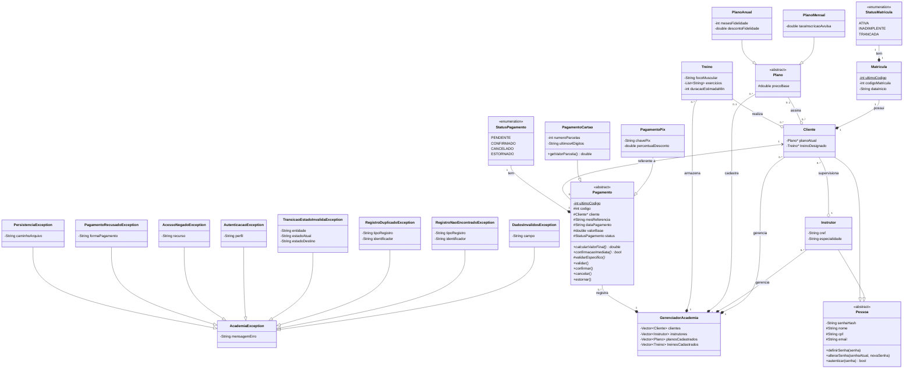

# Sistema de Gestão de uma Academia

## 👥 Integrantes

| Nome | Matrícula |
|---|---|
| Maria Helena Varela Kizerlla Guanaes| 20250033713 |
| Davi Whagner de Lima Hoffmann | 20250060668|
| Luccas Melo de Anadrade | 20250030963|

**Repositório:** https://github.com/helena-varela/sistema-academia

## ▶️ Como Executar

Requisitos: `g++` com suporte a C++17 e `make`.

```bash
make run      # compila e abre o sistema no terminal
```

**Primeiro acesso:** entre como **Gerente** com a senha padrão `admin123` (pode ser trocada no menu do gerente). O gerente cadastra clientes e instrutores e define a senha de cada um.

Os dados são salvos automaticamente em `data/backup.txt` após cada operação e carregados quando o sistema inicia. Mais detalhes na seção **Como Compilar**, abaixo.

---

Esse projeto foi feito para a matéria de **Linguagem de Programação II** e adaptado para a **Atividade da Unidade 03**.

## 🗂️ Arquitetura do Projeto
A arquitetura do projeto foi modularizada para separar as definições de tipos, as implementações lógicas e os arquivos gerados no ciclo de compilação:

```plaintext
/SISTEMA-ACADEMIA
├───/bin                         # Arquivos gerados na compilação
├───/data                        # Arquivos de persistência de dados
├───/include                     # Arquivos de cabeçalho (.hpp)
├───/src                         # Implementação das classes (.cpp)
├───Makefile                     # Automação do processo de compilação
├───.gitignore                   # Arquivos e diretórios ignorados pelo Git
└───README.md                    # Documentação principal do projeto
```

### 1. sistema-academia/ (Raiz): 

Diretório principal do projeto. Contém os arquivos de configuração global como o Makefile , .gitignore e a documentação principal (README.md)

### 2. bin/ (Binários): 

Armazena todos os arquivos de objeto intermediários (.o) e o arquivo executável final do sistema. Esta pasta é gerada automaticamente pelo Makefile e não deve ser enviada para o repositório Git (deve estar no .gitignore).

### 3. data/ (Persistência): 

Destinada aos arquivos de texto (.txt) utilizados para salvar e carregar os dados cadastrais do sistema entre as execuções da aplicação.

### 4. include/ (Cabeçalhos / Headers): 

Contém os arquivos de extensão .hpp. É onde ficam as declarações das 21 classes (12 de domínio, `AcademiaException` e 8 exceções derivadas), atributos, protótipos de métodos e as definições de exceções personalizadas. Nenhuma lógica de código deve ser escrita aqui.

### 5. src/ (Fontes / Source): 

Contém os arquivos de extensão .cpp com a implementação real da lógica declarada nos headers, além do arquivo main.cpp , que gerencia o menu de interação via terminal.


## ⚙️ Como Compilar

### make:

**O que faz:** Compila de forma incremental todo o projeto.

**Como funciona:** O make varre a pasta src/, identifica quais arquivos .cpp foram criados ou modificados, gera seus respectivos arquivos de objeto .o dentro de bin/ e faz a linkagem final para construir o executável. Se nenhum arquivo foi modificado desde a última compilação, ele avisa que o alvo já está atualizado, poupando tempo.

### make run

**O que faz:** Compila o projeto (caso haja alguma alteração pendente) e inicia a aplicação imediatamente.

**Como funciona:** Ele dispara o processo padrão do make e, logo em seguida, executa o arquivo binário gerado, abrindo o menu interativo no terminal. É o comando ideal para testar o código rapidamente durante o desenvolvimento.  

### make clean

**O que faz:** Limpa o ambiente de desenvolvimento deletando os arquivos gerados pela compilação.

**Como funciona:** Ele remove completamente o diretório bin/ e tudo o que está dentro dele. É útil usar este comando antes de criar arquivos compactados (.zip) para entrega  ou para forçar uma compilação do zero quando ocorrer algum erro estranho de cache de arquivos.  

## 📑 Diagrama de Classes

O diagrama também está disponível como imagem em [`docs/mermaid-diagram.png`](docs/mermaid-diagram.png).



## 🧩 Conceitos de POO Aplicados

- **Encapsulamento:** todos os atributos das entidades são privados ou protegidos e só são alterados por métodos que validam as regras.
- **Herança:** `Pessoa` → `Cliente`/`Instrutor`; `Plano` → `PlanoMensal`/`PlanoAnual`; `Pagamento` → `PagamentoPix`/`PagamentoCartao`. Todas as classes filhas têm atributos e comportamentos próprios.
- **Polimorfismo:**
  1. **`Plano`**: `calcularMensalidade()` (mensal soma taxa de inscrição, anual aplica desconto de fidelidade), `aplicarRestricaoAcesso()` (mensal bloqueia horário de pico) e `getMaxParcelasCartao()` (mensal só à vista, anual até 3x).
  2. **`Pagamento`**: `calcularValorFinal()` (Pix dá 5% de desconto, cartão cobra o valor cheio), `confirmacaoImediata()` (Pix confirma na hora, cartão aguarda autorização) e `validarEspecifico()` (cartão confere o limite de parcelas do plano; padrão *Template Method*, chamado por `Pagamento::validar()`).
- **Estado dinâmico (2 classes):**
  - `Matricula`: ATIVA → INADIMPLENTE | TRANCADA, INADIMPLENTE → ATIVA, TRANCADA → ATIVA. Uma matrícula trancada não pode virar inadimplente diretamente.
  - `Pagamento`: PENDENTE → CONFIRMADO | CANCELADO, CONFIRMADO → ESTORNADO. CANCELADO e ESTORNADO são estados finais.
- **Autenticação e autorização:** veja a seção abaixo.
- **Tratamento de exceções:** veja a seção **Exceções Personalizadas**.
- **Persistência:** GerenciadorAcademia::salvarEmArquivo / carregarDeArquivo (planos, treinos, instrutores, clientes com status da matrícula e pagamentos).

## 🚨 Exceções Personalizadas

Todas herdam de `AcademiaException` (que herda de `std::exception`) e ficam em `include/Excecoes.hpp`. Cada uma carrega informações próprias sobre o erro, usadas no tratamento.

| Exceção | Atributos | Quando é lançada (exemplos) |
|---|---|---|
| `DadosInvalidosException` | `campo` | Validação de dados: nome/e-mail vazio, CPF inválido, senha curta, hora fora de 0–23, data ou mês mal formatado, opção de menu inválida (`Pessoa`, `Cliente`, `Treino`, `Pagamento`, menus) |
| `RegistroNaoEncontradoException` | `tipoRegistro`, `identificador` | Cliente, instrutor, pagamento ou aluno supervisionado inexistente (`GerenciadorAcademia::consultar*`, `Instrutor::consultarAlunoSupervisionado`) |
| `RegistroDuplicadoException` | `tipoRegistro`, `identificador` | Cadastro ou alteração com CPF já usado (`GerenciadorAcademia::cadastrarCliente`, `cadastrarInstrutor`) |
| `TransicaoEstadoInvalidaException` | `entidade`, `estadoAtual`, `estadoDestino` | Mudança de estado proibida (`Matricula::alterarEstado`, `Pagamento::confirmar`/`cancelar`/`estornar`) |
| `AutenticacaoException` | `perfil` | Login com usuário ou senha incorretos, senha atual errada ao trocar a senha (`GerenciadorAcademia::autenticar*`, `Pessoa::alterarSenha`) |
| `AcessoNegadoException` | `recurso` | Treino bloqueado por matrícula inadimplente/trancada ou horário de pico; instrutor prescrevendo treino para aluno de outro instrutor (`Cliente::iniciarTreino`, `PlanoMensal::aplicarRestricaoAcesso`, `Instrutor::prescreverTreino`) |
| `PagamentoRecusadoException` | `formaPagamento` | Mês já pago, matrícula trancada, parcelas acima do permitido pelo plano (`GerenciadorAcademia::registrarPagamento`, `Pagamento::validar`, `PagamentoCartao::validarEspecifico`) |
| `PersistenciaException` | `caminhoArquivo` | Falha ao abrir, gravar ou substituir o arquivo de dados (`GerenciadorAcademia::salvarEmArquivo`, `carregarDeArquivo`) |

**Tratamento:** o `main.cpp` captura cada tipo separadamente, da mais específica para a mais geral, e mostra uma mensagem adequada (ex.: `Falha no login (gerente): ...`, `Dado invalido [senha]: ...`). Outros pontos também tratam exceções específicas:
- Ao alterar o CPF, a interface captura `RegistroNaoEncontradoException` para confirmar que o CPF novo está livre.
- Ao iniciar, um `PersistenciaException` (arquivo inexistente) faz o sistema começar com a base vazia.
- Durante o carregamento, uma linha corrompida do arquivo é ignorada com um aviso, sem impedir o carregamento das demais.

## 🔐 Autenticação e Autorização

Todo acesso exige login com senha. As senhas não são gravadas em texto puro: o arquivo guarda apenas um *hash* (`Pessoa::gerarHash`).

| Perfil | Login | Permissões |
|---|---|---|
| **Gerente** | senha do gerente (padrão `admin123`) | Gerencia clientes e instrutores, troca planos, altera o estado de matrículas, registra/confirma/cancela/estorna pagamentos e gera relatórios. |
| **Instrutor** | CREF + senha | Gerencia apenas os **próprios** alunos supervisionados e prescreve treinos para eles. |
| **Cliente** | CPF + senha | Consulta apenas os **próprios** dados, matrícula, plano, treino e pagamentos, e inicia o treino. |

- Cada perfil só vê o seu menu; operações administrativas não aparecem para instrutor nem para cliente.
- A mensagem de erro de login é a mesma para usuário inexistente e senha errada, para não revelar quais CPFs/CREFs estão cadastrados (`GerenciadorAcademia::autenticarCliente`, `autenticarInstrutor`, `autenticarGerente`).
- Todos os perfis podem alterar a própria senha, informando a senha atual.

## 📋 Funcionalidades

| Perfil | Funcionalidade | Além do CRUD? |
|---|---|---|
| Gerente | Cadastrar, consultar, atualizar e remover cliente | |
| Gerente | Cadastrar, consultar, atualizar e remover instrutor | |
| Gerente | Trocar plano do cliente | ✅ |
| Gerente | Alterar estado da matrícula (trancar, reativar etc.) | ✅ |
| Gerente | Registrar pagamento (Pix ou Cartão) | ✅ |
| Gerente | Confirmar pagamento de cartão | ✅ |
| Gerente | Cancelar pagamento pendente | ✅ |
| Gerente | Estornar pagamento | ✅ |
| Gerente | Histórico de pagamentos do cliente | ✅ |
| Gerente | Atualizar inadimplência do mês | ✅ |
| Gerente | Relatório de inadimplentes | ✅ |
| Instrutor | Adicionar / remover aluno da supervisão | ✅ |
| Instrutor | Prescrever treino para aluno supervisionado | ✅ |
| Instrutor | Listar alunos supervisionados | |
| Cliente | Visualizar dados, matrícula, plano e treino | |
| Cliente | Iniciar treino (verifica matrícula e horário do plano) | ✅ |
| Cliente | Consultar os próprios pagamentos | ✅ |
| Todos | Login com senha e alteração da própria senha | ✅ |

## ✅ Regras de Negócio Implementadas

| # | Regra | Onde |
|---|---|---|
| 1 | O plano mensal bloqueia o acesso no horário de pico (18h às 20h); o plano anual não tem restrição. | `PlanoMensal::aplicarRestricaoAcesso`, `PlanoAnual::aplicarRestricaoAcesso` |
| 2 | A mensalidade do plano mensal é o preço base mais a taxa de inscrição; a do anual é o preço base menos o desconto de fidelidade. | `PlanoMensal::calcularMensalidade`, `PlanoAnual::calcularMensalidade` |
| 3 | A matrícula só muda de estado por transições permitidas: ativa pode ficar inadimplente ou trancada; inadimplente e trancada só podem voltar para ativa. | `Matricula::validarTransicao` |
| 4 | O instrutor só pode prescrever treino para alunos que ele supervisiona. | `Instrutor::prescreverTreino` |
| 5 | Só pode iniciar o treino o cliente com matrícula **ativa** (inadimplente ou trancada é bloqueado). | `Cliente::iniciarTreino` |
| 6 | Não pode haver dois pagamentos confirmados ou pendentes do mesmo cliente para o mesmo mês. | `GerenciadorAcademia::registrarPagamento` |
| 7 | Matrícula trancada não recebe pagamento. | `Pagamento::validar` |
| 8 | Pagamento via Pix tem 5% de desconto e é confirmado na hora; pagamento no cartão cobra o valor cheio e fica pendente até ser confirmado. | `PagamentoPix`, `PagamentoCartao` |
| 9 | No cartão, o plano mensal só pode ser pago à vista e o plano anual em até 3 parcelas. | `PagamentoCartao::validarEspecifico`, `Plano::getMaxParcelasCartao` |
| 10 | Após o dia 10, o cliente sem pagamento confirmado do mês fica **inadimplente** (exceto quem se matriculou no próprio mês). Ao confirmar o pagamento, a matrícula volta a ficar **ativa**. | `GerenciadorAcademia::reavaliarSituacaoFinanceira`, `GerenciadorAcademia::atualizarInadimplencia` |

## 📝 Regras de Negócio Identificadas e Não Implementadas

Conforme pedido na atividade, esta seção lista regras que foram identificadas durante a análise do domínio, mas ficaram fora do escopo desta entrega. Todas as funcionalidades e as 10 regras descritas acima estão implementadas.

- **Multa e juros por atraso:** pagamentos feitos após o vencimento deveriam ter multa fixa e juros por dia de atraso.
- **Juros no parcelamento:** parcelamentos longos no cartão deveriam ter juros e um valor mínimo por parcela.
- **Prazo para estorno:** o estorno deveria ter prazo (ex.: Pix só no mesmo dia, cartão em até 7 dias).
- **Multa rescisória do plano anual:** cancelar ou trocar de plano antes de cumprir os meses de fidelidade (`PlanoAnual::mesesFidelidade`) deveria gerar multa.
- **Limite de trancamento:** a matrícula só poderia ficar trancada por um número máximo de dias por ano e voltar a ficar ativa automaticamente depois disso.
- **Cobrança de meses anteriores:** hoje a inadimplência considera apenas o mês atual; meses antigos sem pagamento deveriam ser acumulados como dívida.
- **Limite de alunos por instrutor:** cada instrutor deveria supervisionar no máximo um número fixo de alunos.
- **Treino compatível com a especialidade:** o instrutor só poderia prescrever treinos da sua especialidade.
- **Avaliação física obrigatória:** o cliente só poderia iniciar o primeiro treino após uma avaliação física.
- **Registro de frequência (check-in):** limitar a um acesso por dia e gerar relatório de frequência.
- **Reajuste anual de preços:** os planos seriam reajustados uma vez por ano, sem afetar pagamentos já registrados.
- **Desconto por indicação ou plano família:** clientes que indicam outros ou que compartilham plano teriam desconto.
- **Bloqueio após tentativas de login:** a conta seria bloqueada após 3 tentativas de acesso incorretas.

## ⚠️ Situações de Risco

**1. Dois computadores da recepção usando o sistema ao mesmo tempo**
- **Situação:** duas recepcionistas abrem o sistema em computadores diferentes que compartilham a mesma pasta `data/` e registram, quase ao mesmo tempo, o pagamento de novembro do mesmo cliente.
- **Problema:** cada instância carrega o `backup.txt` só ao iniciar. A verificação de pagamento duplicado em `GerenciadorAcademia::registrarPagamento` olha apenas a memória da própria instância, então as duas aceitam o pagamento. Depois, `salvarEmArquivo` regrava o arquivo inteiro e a última gravação apaga a outra.
- **Impacto:** o cliente é cobrado duas vezes e um dos pagamentos some do backup, embora o dinheiro tenha sido recebido.
- **Mitigação:** criar um arquivo de trava (`data/backup.lock`) que impede abrir uma segunda instância, ou gravar um número de versão no arquivo e recusar o salvamento se ele mudou desde a leitura (lock otimista), lançando uma exceção. Com banco de dados, uma restrição de unicidade por cliente e mês.
- **Classes:** `GerenciadorAcademia`, `Pagamento`.

**2. Inadimplência que depende de o gerente lembrar de atualizar**
- **Situação:** no dia 20 um cliente ainda não pagou o mês, mas o gerente não executou a opção "Atualizar Inadimplência do Mês".
- **Problema:** `GerenciadorAcademia::atualizarInadimplencia` só roda quando chamada pelo menu, e `Cliente::iniciarTreino` confere apenas o estado atual da `Matricula`, que continua `ATIVA`.
- **Impacto:** o cliente devedor continua treinando normalmente e o relatório de inadimplentes sai vazio, dando uma visão errada do financeiro.
- **Mitigação:** executar a atualização automaticamente ao iniciar o sistema e chamar `reavaliarSituacaoFinanceira` para o cliente antes de liberar `iniciarTreino`.
- **Classes:** `GerenciadorAcademia`, `Cliente`, `Matricula`.

**3. Cancelamento do plano anual antes do fim da fidelidade**
- **Situação:** um cliente assina o plano anual, que tem mensalidade menor por causa da fidelidade de 12 meses, e após 2 meses pede para trocar de plano ou para ser removido.
- **Problema:** `Cliente::setPlano` e `GerenciadorAcademia::removerCliente` aceitam a operação a qualquer momento; o atributo `PlanoAnual::mesesFidelidade` é armazenado mas nunca verificado.
- **Impacto:** o cliente recebe o desconto da fidelidade sem cumprir o compromisso, e a academia perde a receita que justificava o desconto.
- **Mitigação:** antes de trocar ou cancelar, comparar a data de início da `Matricula` com `mesesFidelidade` e cobrar multa rescisória ou recusar a operação com uma exceção específica (ex.: `FidelidadeVigenteException`).
- **Classes:** `Cliente`, `PlanoAnual`, `Matricula`.

**4. Remoção de cliente apaga o histórico financeiro**
- **Situação:** um cliente encerra a matrícula em dezembro e é removido. Em janeiro ele contesta, na operadora do cartão, uma cobrança de novembro.
- **Problema:** `GerenciadorAcademia::removerCliente` apaga o cliente e todos os seus objetos `Pagamento`. Além disso, `Matricula::ultimoCodigo` é recalculado a partir do maior código existente ao carregar o arquivo, então o número de matrícula do cliente removido pode ser reaproveitado por um novo cliente.
- **Impacto:** a academia não tem como comprovar a cobrança, e documentos antigos com aquele número de matrícula passam a apontar para outra pessoa.
- **Mitigação:** usar exclusão lógica: um novo estado final `CANCELADA` em `StatusMatricula` impede login e novos pagamentos, mas mantém o cliente e o histórico no arquivo. Gravar também o último código gerado no backup.
- **Classes:** `GerenciadorAcademia`, `Cliente`, `Matricula`, `Pagamento`.

**5. Relógio do computador com a data errada**
- **Situação:** o computador da recepção está com a data adiantada, marcando 15/11 quando na verdade é 05/11 (bateria da placa-mãe, fuso errado ou alteração manual).
- **Problema:** `GerenciadorAcademia::atualizarInadimplencia` e `clienteEmDia` comparam o dia atual com `Pagamento::DIA_VENCIMENTO` usando a data do sistema operacional, e o mês de referência padrão de um novo `Pagamento` também vem dessa data.
- **Impacto:** clientes que ainda estão dentro do prazo são marcados como inadimplentes e têm o treino bloqueado por `Cliente::iniciarTreino`; com o relógio atrasado no fim do mês, um pagamento pode ser registrado no mês errado.
- **Mitigação:** guardar no backup a maior data já usada em uma operação e recusar operações com data anterior a ela (ex.: `DataInconsistenteException`), além de exibir a data atual na tela de pagamento para conferência; em uma versão com servidor, usar a data do servidor sincronizada por NTP.
- **Classes:** `GerenciadorAcademia`, `Pagamento`, `Cliente`.
